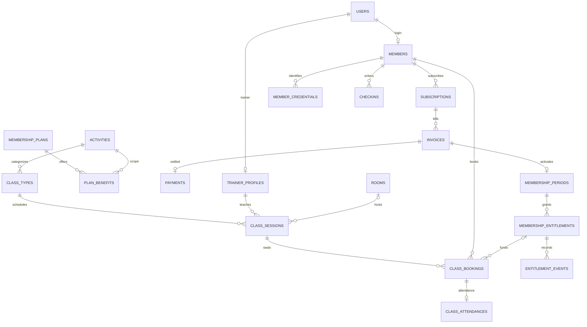

# Rancangan Gym, Pilates, kelas, personal trainer dan QR anggota

Status: proposal implementasi, bukan fitur live atau migration yang sudah dijalankan.
Target: Laravel 13 / PHP 8.3, MySQL InnoDB pada Hostinger; Blade + Vite.
Satu lokasi gym untuk tahap awal. Pembayaran tetap manual dan satu invoice membeli satu paket.

## Prinsip domain

- Akun login (`users`) berbeda dari orang/anggota (`members`). Anggota tanpa akun tetap bisa mempunyai kartu QR cetak.
- Aktivitas Gym dan Pilates mempunyai hak akses sendiri. Paket PT adalah layanan sesi dengan trainer.
- Harga dan manfaat paket disalin saat invoice dibuat. Pembayaran mengaktifkan hak sesuai snapshot, bukan konfigurasi paket terbaru.
- QR mengidentifikasi anggota; backend memutuskan apakah akses saat ini valid. QR tidak menjadi bukti pembayaran.
- Booking kelas, kehadiran kelas dan check-in gedung adalah tiga kejadian berbeda.
- Kalender dan batas masa berlaku disimpan UTC, ditampilkan Asia/Makassar. Interval waktu menggunakan starts_at <= waktu < ends_at.

## Tabel existing yang dipertahankan

users, members, membership_plans, subscriptions, invoices, payments, membership_periods,
staff_shifts, checkins, checkin_attempts, audit_logs, sessions/cache/jobs.
UUID tetap digunakan pada entitas bisnis; foreign key ke users memakai BIGINT sesuai schema existing.
Nominal tetap integer rupiah. Data keuangan dan kehadiran memakai FK RESTRICT, tidak dihapus melalui cascade.

## Schema tambahan dan perubahan

| Tabel | Kolom utama | Relasi / aturan |
| --- | --- | --- |
| activities | UUID id, unique code, name, is_active | Seed `gym` dan `pilates`; varian reformer/mat bisa menjadi aktivitas terpisah bila manfaatnya berbeda |
| trainer_profiles | UUID id, user_id unique FK, bio nullable, is_bookable | users 1 : 0..1 profil trainer; akun harus aktif dan role sesuai |
| trainer_activities | trainer_id FK, activity_id FK | Composite primary key; bidang yang dapat diajar trainer |
| rooms | UUID id, unique code, name, capacity, is_exclusive, is_active | Studio eksklusif tidak boleh bentrok; area Gym umum tidak mengunci seluruh lantai untuk satu PT |
| plan_benefits | UUID id, plan_id FK, activity_id FK, benefit_type, unit_limit nullable, credits_per_booking, policy_snapshot JSON | Unique(plan_id, activity_id, benefit_type). benefit_type: facility_access, group_class, personal_training. NULL limit = unlimited, 0 = tidak memberikan hak |
| membership_entitlements | UUID id, period_id FK, activity_id FK, benefit_type, starts_at, ends_at, unit_limit nullable, reserved_units default 0, consumed_units default 0, policy_snapshot JSON | Unique(period_id, activity_id, benefit_type). Hak beli yang immutable selain counter reservasi/pemakaian. CHECK counters >= 0 dan reserved + consumed <= limit jika bounded |
| class_types | UUID id, activity_id FK, name, kind, duration_minutes, default_capacity, required_benefit_type | kind: group/personal; sesi personal kapasitas 1. PT tidak disamakan dengan tiket masuk gedung |
| class_series | UUID id, class_type_id FK, trainer_id FK, room_id FK nullable, recurrence JSON, timezone, effective_from, effective_until, status | Pola mingguan; generator membuat sesi nyata untuk jangka terbatas, mis. 8 minggu |
| class_sessions | UUID id, series_id FK nullable, class_type_id FK, trainer_id FK, room_id FK nullable, starts_at, ends_at, booking_opens_at, booking_closes_at, capacity, reserved_seats default 0, status | CHECK ends > starts, 0 <= reserved_seats <= capacity. Unique(series_id, starts_at) untuk generator idempotent. Status scheduled/completed/cancelled |
| class_bookings | UUID id, session_id FK, member_id FK, entitlement_id FK nullable, status, reserved_units, booked_at, cancelled_at nullable, cancellation_reason nullable, created_by FK users | Unique(session_id, member_id); rebooking mengaktifkan baris yang sama. Status confirmed/cancelled/attended/no_show; tambah waitlisted hanya saat fitur antrean benar-benar dibuat |
| entitlement_events | UUID id, entitlement_id FK, booking_id FK nullable, checkin_id FK nullable, event_type, units, unique request_key UUID, actor_user_id FK, created_at | Ledger reserve/release/consume/restore. Constraint event_type dan FK sumber; counter dan ledger ditulis pada transaksi yang sama. Koreksi append event, tidak menghapus sejarah |
| class_attendances | UUID id, booking_id unique FK, checked_in_at, recorded_by FK users, method | Hanya peserta dengan booking confirmed dapat dicatat hadir, saat jendela kehadiran valid |
| member_credentials | UUID id, member_id FK, token_hash CHAR(64) unique, token_ciphertext TEXT, issued_by FK users, issued_at, expires_at nullable, revoked_at nullable, last_used_at nullable | Token random 256 bit. Hash untuk lookup; ciphertext terenkripsi APP_KEY untuk menampilkan QR lagi. Tidak menyimpan token plaintext. Rotasi revoke credential lama dan buat baru |
| scan_requests | UUID request_key PK, actor_user_id FK, purpose, member_id FK nullable, checkin_id FK nullable, attendance_id FK nullable, result_code, created_at | Idempotency hasil scan; tidak menyimpan QR mentah. Identitas actor dan purpose harus cocok sebelum hasil lama dikembalikan |

Perubahan existing:
- users.role tambah `personal_trainer`; gunakan PHP Enum role dan Policies, bukan kondisi role tersebar di Blade. Single-role dipertahankan untuk kompatibilitas. `users` bisa tetap terhubung ke `members` bila trainer juga anggota; navigasi/Policy menentukan haknya. Pivot user_roles baru diperlukan bila satu akun memang harus memegang beberapa role operasional sekaligus.
- membership_plans tambah `renewal_scope_key` dan `period_start_policy` (queue_same_scope / immediate).
- membership_periods menyimpan snapshot renewal_scope_key; invoice.snapshot menyimpan seluruh plan_benefits dan kebijakan pembatalan.
- checkins tambah activity_id FK, entitlement_id FK nullable, credential_id FK nullable, unique request_key UUID nullable. Pertahankan membership_period_id.
- checkin_attempts.member_id dibuat nullable untuk token tidak dikenal; tambah credential_id nullable, activity_id nullable, method, request_key. Jangan menyimpan nilai QR mentah.
- Tidak perlu invoice_items/payments gateway untuk satu paket per invoice. Tambahkan invoice_items hanya bila checkout multiproduk dibutuhkan kelak.

## Relasi inti

## Paket dan masa berlaku

Contoh produk:
- Gym Monthly: facility_access Gym tanpa batas selama satu bulan; queue_same_scope `gym_access`.
- Pilates 8 Sessions: group_class Pilates 8 kredit selama 30 hari; immediate `pilates_pack`.
- PT 4 Sessions: personal_training Gym 4 kredit selama 30 hari; immediate `pt_pack`.
- Gym + Pilates: satu invoice dengan beberapa benefit; scope `gym_pilates_combo` dengan masa paket yang disepakati. Kombinasi dan produk terpisah tidak otomatis saling memperpanjang.

Perbaikan wajib pada MembershipService::settle(): query akhir periode berikutnya hanya pada scope yang sama dan member yang sama. Pembelian Pilates tidak boleh menunggu Gym berakhir. Snapshot scope dipakai untuk historis.
`Member.currentPeriod` tidak lagi menjadi satu-satunya sumber akses. Tambahkan resolver `AccessService` yang memilih entitlement aktif untuk aktivitas dan tujuan tertentu; paket aktif dapat lebih dari satu.
Jika beberapa entitlement sesuai, pilih berakhir paling cepat dahulu (FEFO). Jangan menggabungkan sisa kuota atau periode secara diam-diam.
Membership untuk booking harus valid pada waktu sesi, bukan hanya pada hari pemesanan. Bedakan hak kelas dan hak fasilitas pada kartu member.

## Booking dan kredit

1. Member memilih aktivitas, tanggal dan sesi nyata; biaya kredit ditampilkan sebelum konfirmasi.
2. Policy memeriksa kepemilikan anggota, suspensi, waktu booking, entitlement dan konflik jadwal anggota.
3. Transaksi InnoDB: lock member -> class_session -> entitlement dengan urutan konsisten; cek ulang status/kuota/kapasitas.
4. Tambah reserved_seats dan reserved_units, insert/upsert booking, append ledger reserve. Unique request_key mencegah request ulang mengonsumsi kuota lagi.
5. Kehadiran memindahkan reserved_units ke consumed_units dalam satu transaksi; hadir tidak mengurangi kredit kedua kali. Kursi tetap terisi untuk sesi tersebut.
6. Cancel sebelum cutoff: release kursi dan kredit sekali. Terlambat/no-show mengikuti snapshot policy (mis. kredit consumed). UI harus menampilkan aturan sebelum booking.
7. Cancel oleh gym: release semua reservasi tanpa penalti, catat audit. Reschedule ke waktu baru membutuhkan validasi entitlement peserta ulang; jangan mengubah diam-diam.
8. Jika sesi finished tetapi anggota tidak hadir, job idempotent mengubah confirmed -> no_show. Bila cron belum tersedia, admin bisa menjalankan proses ini manual terlebih dahulu.

Tidak mengandalkan counter frontend atau `count()` tanpa lock. Pastikan booking terakhir untuk satu kursi/kredit hanya berhasil pada satu request, dengan test dua koneksi MySQL.
Generator sesi menggunakan unique(series_id, starts_at) dan tidak memodifikasi sesi yang sudah memiliki booking ketika pola series diedit.
Untuk perubahan jadwal, lock trainer dan room eksklusif (urut ID) sebelum mencari overlap: existing.starts_at < new.ends_at AND existing.ends_at > new.starts_at. Semua jalur penjadwalan memakai lock yang sama.
Tambahkan trainer_availability/trainer_time_off bila UI jam kerja/cuti dibangun; kehadirannya harus ikut pemeriksaan konflik, bukan hanya warna kalender.

## Role dan halaman

| Hak | Owner | Receptionist | Personal trainer | Member |
| --- | --- | --- | --- | --- |
| Paket, harga, staf, kebijakan | Ya | Tidak | Tidak | Tidak |
| Registrasi, invoice, pembayaran manual | Ya | Ya | Tidak | Invoice milik sendiri, tanpa konfirmasi lunas |
| Scan akses gedung / fasilitas | Ya | Ya | Tidak | Menampilkan kartu sendiri |
| Atur kelas dan penugasan trainer | Ya | Sesuai permission `schedule.manage` | Lihat jadwal sendiri | Lihat sesi tersedia |
| Peserta / absensi kelas | Semua | Semua | Sesi yang ditugaskan, data minimum | Booking / absensi sendiri |
| Booking / pembatalan | Semua sesuai policy | Untuk anggota | Tidak mengubah peserta sembarang sesi | Milik sendiri sesuai policy |
| Laporan finansial | Ya | Shift milik sendiri | Tidak | Pembayaran sendiri |

Owner/admin sekarang tetap role `owner`; jangan membuka role baru `admin` yang isinya sama. Trainer tidak mendapat akses laporan keuangan, seluruh kontak anggota, atau endpoint frontdesk.
Halaman member: membership per aktivitas, kalender Gym/Pilates/PT, booking saya, kartu QR, pembayaran.
Halaman tim: jadwal studio/trainer, kapasitas peserta, registrasi cepat, scan, daftar kehadiran.
Halaman trainer: hari ini, kalender sendiri, roster kelas yang ditugaskan, tandai hadir (Policy per sesi).

## QR dan scan kamera web

- Gunakan QR 2D dengan payload `PG1:<random-token>`, bukan email, user ID, nomor telepon atau tanggal berlaku. Format dapat dicetak dan juga ditampilkan di member portal.
- Satu credential aktif per anggota secara default. Rotasi dilakukan dengan lock member, revoke credential sebelumnya. Credential mempunyai expiry/revoke sendiri, sedangkan membership diperiksa setiap scan.
- QR statis dapat difoto/disalin. Tampilkan nama dan nomor anggota kepada receptionist untuk verifikasi identitas; foto anggota opsional bila fitur upload dibangun. Jangan menjanjikan QR statis anti-sharing. Dynamic QR TTL pendek adalah tahap tambahan, bukan syarat untuk kartu cetak.
- GET /frontdesk/scan hanya owner/receptionist. Tombol Mulai kamera meminta video environment-facing dan audio false; opsi ganti kamera serta stop kamera. Jangan menyalakan kamera otomatis saat dashboard dibuka.
- Decode lokal memakai BarcodeDetector jika mendukung qr_code, fallback ZXing browser bundle version-pinned/lazy-loaded. Jangan mengambil script scanner dari CDN runtime.
- Stop decode setelah token ditemukan, POST sekali ke backend dengan CSRF dan UUID request_key. Setelah hasil muncul, staf menekan Scan berikutnya. Kamera dihentikan saat halaman hidden/ditutup dan ketika pengguna menekan Stop.
- POST /frontdesk/scans menerima token, activity_id, purpose facility/class, session_id jika class, request_key. Batas panjang/format, rate limit per staf, scope Policy, tanpa endpoint publik yang membocorkan nama anggota.
- Facility: cek user aktif (jika terhubung), member aktif, token tidak revoked/expired, entitlement activity aktif pada now, kuota dan jendela duplicate; transaksi lock member/credential/entitlement -> checkin+ledger+attempt+audit.
- Class: cek booking untuk session yang dipilih dan jendela kehadiran. Idempotent attendance unique booking_id. Jangan menggunakan dedup gedung untuk menolak attendance kelas; keduanya kejadian berbeda.
- Scan tidak pernah membuat invoice paid, mengubah periode atau mengaktifkan user.
- Hasil: SUCCESS, UNKNOWN_CREDENTIAL, REVOKED_CREDENTIAL, CREDENTIAL_EXPIRED, ACCOUNT_DISABLED, MEMBER_SUSPENDED, NO_ACTIVITY_ACCESS, MEMBERSHIP_EXPIRED, NO_CREDITS, DUPLICATE_CHECKIN, NOT_BOOKED, OUTSIDE_ATTENDANCE_WINDOW.
- Manual member_number tetap tersedia bagi staff sebagai fallback ketika kamera tidak tersedia; gunakan AccessService dan audit yang sama, bukan jalur bypass.
- HTTPS + izin kamera browser wajib. SecurityHeaders saat ini `camera=()`; ubah menjadi `camera=(self)` HANYA pada GET scanner yang berizin. Microphone/geolocation tetap diblokir. Route lain tetap camera=(). Tambahkan CSRF/no-store; QR mentah tidak masuk query URL/log/analytics.
- Tidak mengizinkan scan offline untuk grant akses; tampilkan koneksi putus dan lakukan verifikasi online/manual oleh staff.

## Modul Laravel

Pisahkan controller/UI dari transaksi domain, tetap memakai folder aplikasi existing:
- AccessService: resolution dan konsumsi hak fasilitas.
- CredentialService: issue, display/decrypt untuk pemilik, rotate, revoke.
- BookingService: reserve, cancel, capacity, entitlement.
- ScheduleService: sesi, series, trainer/room conflict.
- AttendanceService: hadir/no-show, kredit.
- MembershipService existing: invoice, settlement, snapshot -> entitlement creation; metode pembayaran manual tetap cash/bank_transfer/qris/card/other.
- FormRequests untuk validasi input; Policies untuk owner/receptionist/trainer assigned/member owner; Enum untuk role/status/metode yang konsisten.
- Jangan memakai model observers untuk aktivasi pembayaran atau konsumsi kredit tersembunyi.

Gunakan DB transaction dan row lock, UUID request keys, unique constraints, retry deadlock terbatas. Urutan lock didokumentasikan per operasi; bulk operasi lock ID ascending. Validasi harga/kuota di server. Event notifications hanya setelah commit.
Tidak memerlukan microservices, websocket, Redis atau gateway untuk fase ini. Database queue + cron Hostinger cukup untuk generator/no-show/reminder saat diperlukan; core scan/booking/settlement tetap sinkron.

## Index dan constraint

- class_sessions(trainer_id, starts_at, ends_at), (room_id, starts_at, ends_at), (status, starts_at).
- class_bookings(member_id, status, session_id), unique(session_id, member_id).
- membership_entitlements(period_id, activity_id, benefit_type) unique; pencarian aktif member melalui indexed membership_periods(member_id,status,starts_at,ends_at).
- member_credentials.token_hash unique; (member_id, revoked_at); satu active credential ditegakkan lock/transaction dan test.
- checkins(member_id, activity_id, checked_in_at); request_key unique nullable untuk backfill lama.
- ledger request_key unique dan attendance booking_id unique.
- booking entitlement harus benar-benar dimiliki member dan activity/benefit-nya cocok dengan session: FK biasa tidak membuktikan aturan lintas tabel ini, Service+Policy wajib memeriksa dalam transaksi.
- Capacity, status dan positif unit menggunakan CHECK yang didukung versi MySQL server; pastikan versi aktual dahulu. Status Enum PHP, kolom VARCHAR supaya migrasi penambahan status tidak memerlukan DB ENUM.

## Migrasi bertahap tanpa kehilangan data

1. Backup database dan key. Tambah tabel/kolom nullable terlebih dahulu, jangan migrate:fresh.
2. Seed aktivitas Gym/Pilates dan backfill manfaat paket existing menjadi Gym facility_access dengan visit_limit lama. Produk existing tidak mendapat kredit Pilates/PT otomatis.
3. Backfill entitlement dari snapshot periode/invoice existing; Gym consumed_units berasal dari checkins lama. Jangan mengambil harga/manfaat historis dari paket yang sudah diedit.
4. Isi scope Gym untuk periode lama, sesuaikan resolver dan settlement. Uji kembali renewal/no-double-payment sebelum mengaktifkan paket gabungan.
5. Role/profil trainer dan jadwal; booking/ledger; scan QR; aktifkan masing-masing setelah pengujian.
6. Tambah FK/constraint non-null setelah validasi backfill. Rilis fitur kamera hanya sesudah SecurityHeaders scanner diperbarui dan dites pada perangkat nyata.
7. QR harus dibuat explicit/batch aman dan dapat diputar ulang; jangan menaruh QR milik semua anggota dalam seeder publik.

## Uji penerimaan

- Semua kombinasi role termasuk trainer menolak anggota/sesi orang lain.
- Gym valid + Pilates expired: scan Gym berhasil, booking Pilates ditolak; paket Pilates baru langsung berlaku walau Gym masih aktif.
- Masa berlaku tepat ends_at ditolak; sesi setelah expiry tidak dapat dipesan.
- Last seat/credit: dua request serentak menghasilkan satu booking saja di MySQL, bukan hanya SQLite test.
- Repeat POST pembayaran/booking/scan/cancel tidak menggandakan ledger, attendance atau masa aktif.
- Cash membutuhkan shift terbuka; QRIS/transfer tidak menambah expected_cash.
- QR tidak dikenal/revoked/expired/suspended ditolak, manual fallback memakai aturan sama.
- Kamera denied/unavailable, HTTPS, Android Chrome, iOS Safari dan desktop webcam; stop track saat pindah halaman.
- Trainer/ruang overlap, dua admin membuat jadwal serentak, series exception/reschedule/cancellation.
- Backfill menghasilkan kuota Gym lama yang sama; perubahan paket tidak mengubah hak beli lama.

## Referensi primer

- Kamera dan HTTPS: https://developer.mozilla.org/en-US/docs/Web/API/MediaDevices/getUserMedia
- Dukungan BarcodeDetector tidak universal: https://developer.mozilla.org/en-US/docs/Web/API/BarcodeDetector
- Decoder fallback browser: https://github.com/zxing-js/browser

Pilihan dependency scanner/generator QR perlu dikonfirmasi saat implementasi, sesuai aturan proyek tentang perubahan dependency.
